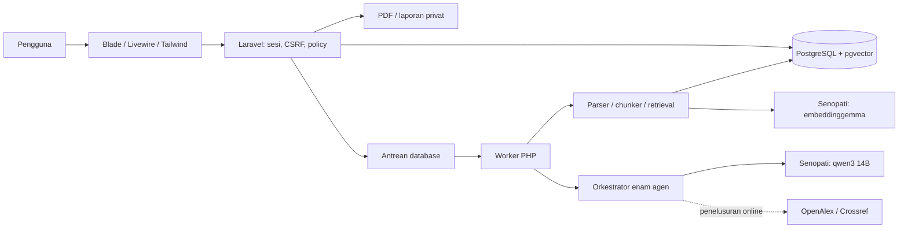
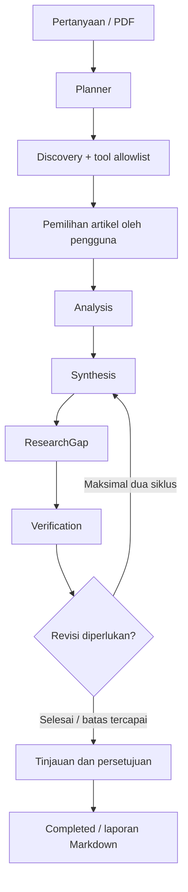
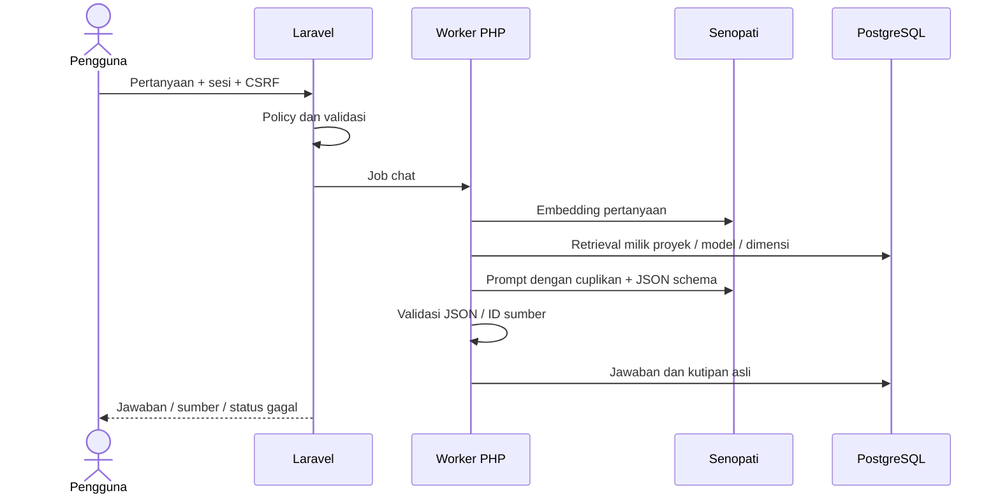
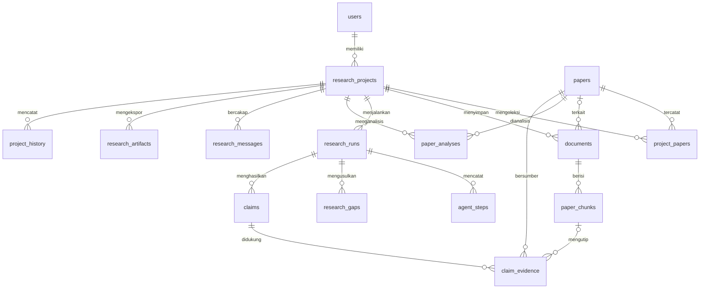

# ResearchMate AI

Asisten riset dengan enam agen PHP, RAG dari PDF privat, dan seluruh inferensi melalui **gateway Senopati ITS**. Chat/agen menggunakan `qwen3:14b`; embedding menggunakan `embeddinggemma:latest`. Aplikasi tidak menjalankan atau membutuhkan model AI lokal.

PDF, database PostgreSQL/pgvector, dan laporan disimpan pada komputer. Pertanyaan, prompt, metadata, hasil tahap sebelumnya, dan teks sumber yang diperlukan dikirim ke Senopati. Semua inferensi memerlukan internet, token kelompok, dan kuota gateway. Mode **dokumen lokal** membatasi sumber pada PDF proyek dan menonaktifkan OpenAlex/Crossref; mode ini bukan inferensi offline.

## Fitur dan panduan

Autentikasi Laravel/Fortify, CRUD proyek dengan policy kepemilikan, PDF privat dengan validasi/hash, parser halaman/chunk, embedding remote, retrieval cosine pgvector, chat dengan kutipan asli, enam agen dengan schema JSON, tool allowlist, workflow persisten, checkpoint pemilihan sumber/persetujuan, bounded retry/revisi, monitor Livewire, matriks literatur, kandidat celah, dan ekspor Markdown.

| Panduan | Isi |
| --- | --- |
| [Fase 1](docs/phase-1.md) / [Fase 2](docs/phase-2.md) | Fondasi, auth, database, proyek |
| [Fase 3](docs/phase-3.md) / [Fase 4](docs/phase-4.md) | Gateway, PDF, embedding, RAG |
| [Fase 5](docs/phase-5.md) / [Fase 6](docs/phase-6.md) | Agen, alat, state, fitur riset |
| [Fase 7](docs/phase-7.md) / [Fase 8](docs/phase-8.md) | UI, kualitas, operasi |
| [Senopati](docs/senopati.md) | Endpoint, token, model, kegagalan |
| [Demo](docs/demo.md) / [Testing](docs/testing.md) | Bukti nyata dan batas pemeriksaan |
| [Data pengujian](docs/test-data.md) | Proyek dan lima PDF untuk mencoba aplikasi |

## Prasyarat

PHP 8.3+, Composer 2, Node.js 22.12+, PostgreSQL dengan pgvector, dan token Senopati. Lingkungan implementasi memakai PHP 8.4.26, Laravel 13.35, Livewire 4.4.7, Flux Free 2.20.1, Tailwind 4/Vite 8.3.4, PostgreSQL 16.15/pgvector 0.8.6. Versi paket dikunci di lockfile. GPU dan unduhan model di komputer pengguna tidak diperlukan.

Ekstensi PHP: curl, fileinfo, mbstring, openssl, PDO/pdo_pgsql, serta ekstensi standar Laravel. Test SQLite memerlukan pdo_sqlite. Jalankan `composer check-platform-reqs` untuk persyaratan paket aktual.

## Instalasi

Dari root repositori:

```powershell
composer install
npm.cmd ci
npm.cmd run build
if (-not (Test-Path -LiteralPath '.env')) { Copy-Item -LiteralPath '.env.example' -Destination '.env' }
```

Pasang pgvector yang cocok dengan versi mayor PostgreSQL; `CREATE EXTENSION` hanya mengaktifkan berkas extension yang sudah terpasang. Contoh setup database baru, port standar 5432:

```powershell
createuser -h 127.0.0.1 -p 5432 -U postgres -P -S -D -R researchmate
createdb -h 127.0.0.1 -p 5432 -U postgres -O researchmate researchmate
psql -h 127.0.0.1 -p 5432 -U postgres -d researchmate -c 'CREATE EXTENSION IF NOT EXISTS vector;'
```

Isi `.env` dengan role aplikasi tanpa superuser dan token kelompok. Jangan mengganti kredensial/key instalasi yang sudah berisi data.

```dotenv
DB_CONNECTION=pgsql
DB_HOST=127.0.0.1
DB_PORT=5432
DB_DATABASE=researchmate
DB_USERNAME=researchmate
DB_PASSWORD=isi_password_database
SENOPATI_API_KEY=isi_token_kelompok
SENOPATI_CHAT_MODEL=qwen3:14b
SENOPATI_EMBED_MODEL=embeddinggemma:latest
SENOPATI_TIMEOUT=300
```

```powershell
# Hanya untuk instalasi baru tanpa APP_KEY:
php artisan key:generate
php artisan config:clear
php artisan migrate
php artisan ai:setup-vector
php artisan ai:check
```

Aktifkan vector sebelum migrasi. Bila kolom awal masih text, `ai:setup-vector` mengonversinya secara transaksional tanpa menghapus data; cadangkan database sebelum perubahan tipe. Kolom vector tidak mengunci dimensi. Model gateway yang diuji menghasilkan **768 dimensi**, tetapi aplikasi memvalidasi output model sebenarnya.

## Menjalankan aplikasi

Gunakan dua terminal:

```powershell
php artisan serve --host=127.0.0.1 --port=8000
```

```powershell
php artisan queue:work --tries=3 --timeout=1800 --sleep=1
```

Buka [ResearchMate](http://127.0.0.1:8000). Worker diperlukan untuk PDF, chat, dan alur agen. Sesudah perubahan konfigurasi/source, clear config dan restart worker. `retry_after=1860` lebih besar dari timeout worker. PHP Windows tidak menyediakan pcntl sehingga timeout total worker tidak dipaksakan seperti pada runtime yang mendukungnya; timeout HTTP tetap berlaku.

Runtime portabel komputer implementasi berada di `%LOCALAPPDATA%\ResearchMate\runtime`. PHP ada di `php\php.exe`, PostgreSQL 16 di `postgresql16\pgsql\bin`, cluster di `%LOCALAPPDATA%\ResearchMate\postgres16-data`, port **55433**. PG18 lama pada port 55432 tetap terpisah. Jangan membuat ulang cluster untuk menjalankan aplikasi.

```powershell
$rmRuntime = Join-Path $env:LOCALAPPDATA 'ResearchMate\runtime'
$env:Path = "$rmRuntime\php;$rmRuntime;$rmRuntime\postgresql16\pgsql\bin;$env:Path"
powershell.exe -NoProfile -ExecutionPolicy Bypass -File .\scripts\start-local.ps1
```

Skrip memulai PostgreSQL 16 yang telah disiapkan, migrasi, server, dan satu worker repo tanpa jendela tambahan. Skrip tidak memasang dependensi, tidak membuat cluster, dan tidak memulai AI lokal. `-Port 8001` hanya mengganti port web. Log ada di `storage/logs`.

## Konfigurasi dan operasi

`.env.example` mendokumentasikan semua konfigurasi. Token hanya di `.env` yang diabaikan Git; endpoint Senopati tetap HTTPS dan redirect dinonaktifkan. Token tidak ditampilkan di UI atau pesan error. `SENOPATI_TIMEOUT=300`, `AI_MAX_RETRIES=2`, `AI_MAX_OUTPUT_TOKENS=4096`, `AI_MAX_PAPERS=20`, `AI_MAX_TOOL_CALLS=40`, `AI_MAX_DOCUMENT_CHUNKS=1000`. PDF maksimal 20 MB; chunk 1200 karakter/overlap 200; retrieval enam sumber. PHP upload/post limit harus mencukupi.

Setelah mengganti model/dimensi embedding, indeks ulang proyek dengan `php artisan ai:reindex ID --force`. Indeks pengganti dibuat atomik per PDF; referensi chunk yang diganti ditandai perlu tinjauan. PDF asli tetap disimpan. Cadangkan PostgreSQL dan `storage/app/private` sebelum perubahan. Metadata artikel global dipertahankan saat proyek dihapus; PDF/hasil milik proyek dibersihkan setelah commit. PDF dan laporan diunduh melalui policy, tanpa symlink publik.

`OPENALEX_API_KEY` opsional untuk penelusuran akademik online. OpenAlex/Crossref memakai host tetap, cache, timeout, dan retry terbatas. Mailer log menyimpan tautan reset password lokal; log tersebut privat. `GET /api/projects/{project}/status` memakai sesi, policy, dan throttle; gunakan `Accept: application/json`. Mutasi memakai CSRF.

## Arsitektur









## Pengujian dan batas hasil

```powershell
composer validate --strict
composer check-platform-reqs
composer test
npm.cmd run build
php artisan ai:check
```

Suite menggunakan HTTP mock, database test terpisah, serta test gateway nyata opsional. [Testing](docs/testing.md) mencatat hasil yang benar-benar dijalankan. CI remote belum dikonfirmasi. Kegagalan koneksi/token/kuota/schema tidak diganti dengan hasil rekaan.

OCR belum tersedia. Analisis agen membaca maksimal **12 chunk terpilih per artikel dari bagian utama dan sampel merata**, sedangkan chat memakai retrieval seluruh indeks yang sesuai. Status full_text berarti PDF tersedia, bukan seluruh artikel dibaca model. Kutipan yang cocok tidak menjamin atribusi atau kesimpulan ilmiah benar. Kandidat celah hanya berlaku pada koleksi proyek; metadata dokumen lokal tetap belum diverifikasi eksternal. Persetujuan pengguna tidak mengubah batas ini.

Matriks, kandidat celah, klaim, dan ekspor mengikuti run terbaru; analisis setiap run disimpan terpisah. Pengaturan dan koleksi proyek terkunci hingga workflow selesai atau dibatalkan. Tunggu pengindeksan PDF selesai sebelum memulai workflow. Jawaban chat memeriksa ulang sumber sebelum disimpan, dan tautan sumber historis disembunyikan setelah indeks berubah. Batch embedding berhasil disimpan sementara dalam cache agar retry tidak mengulang seluruh PDF.

## Pemecahan masalah

| Gejala | Tindakan |
| --- | --- |
| HTTP 401/403 | Periksa token dan izin kelompok. |
| HTTP 429 | Kuota/batas gateway; coba kembali setelah tersedia. |
| Gateway timeout | Periksa internet dan layanan; lanjutkan tahap tersimpan. |
| PDF queued | Hidupkan worker dan periksa log/status. |
| Retrieval kosong setelah ganti model | Indeks ulang dengan --force dan tunggu selesai. |
| Vector tidak tersedia | Pasang extension yang cocok, aktifkan di database, jalankan ai:setup-vector. |
| PostgreSQL menolak koneksi | Periksa cluster/port 5432 atau 55433 dan .env. |
| npm ditolak PowerShell | Gunakan npm.cmd. |
| Perubahan konfigurasi belum berlaku | config:clear, queue:restart, lalu hidupkan worker kembali. |
| PDF pindai | Gunakan PDF teks; OCR belum tersedia. |

Source utama: [gateway](app/Services/AI/SenopatiService.php), [orkestrator](app/Services/AI/AgentOrchestrator.php), [route](routes/web.php), [migrasi](database/migrations/2026_10_09_000003_create_research_tables.php), [layanan PDF](app/Services/Documents). Lisensi starter MIT.
