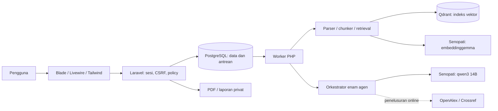
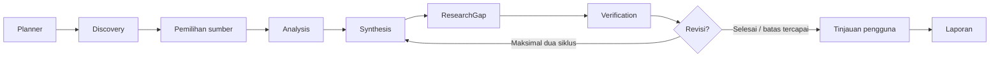

# ResearchMate AI

Asisten riset akademik dengan enam agen PHP, RAG dari PDF privat, dan inferensi melalui **gateway Senopati ITS**. Chat/agen memakai `qwen3:14b`; embedding memakai `embeddinggemma:latest`. Aplikasi tidak memerlukan model AI lokal atau GPU.

**PostgreSQL** menyimpan akun, proyek, metadata, chunk, antrean, dan hasil riset. **Qdrant** menyimpan indeks vektor untuk pencarian semantik. PDF dan laporan disimpan privat. Pertanyaan, prompt, metadata, hasil tahap sebelumnya, dan teks sumber yang diperlukan dikirim ke Senopati melalui HTTPS. Mode **dokumen lokal** membatasi sumber pada PDF proyek dan menonaktifkan OpenAlex/Crossref; inferensi tetap memerlukan internet, token, dan kuota gateway.

## Fitur

[Presentasi proyek (15 slide)](output/presentasi-researchmate/ResearchMate_AI_Kelompok_11_Qdrant_Docker_Final.pptx) memuat tampilan aplikasi dan arsitektur PostgreSQL, Qdrant, serta Docker.

- Autentikasi Laravel/Fortify, policy kepemilikan proyek, unggahan PDF privat dengan validasi/hash, parser halaman dan chunk.
- Embedding remote, retrieval cosine Qdrant yang mempertimbangkan topik, pertanyaan, dan kata kunci dengan filter proyek/model/dimensi, serta chat dengan kutipan sumber asli. Discovery mengurutkan kandidat artikel berdasarkan relevansi terhadap proyek.
- Planner, Discovery, Analysis, Synthesis, ResearchGap, dan Verification; schema JSON, alat terbatas, workflow persisten, checkpoint pemilihan sumber dan persetujuan, retry/revisi terbatas, serta monitor Livewire.
- Matriks literatur, metadata khusus proyek, daftar pustaka APA/IEEE, kandidat celah riset, verifikasi klaim, serta laporan Markdown, Word, dan PDF.

Analisis membaca seluruh teks terindeks untuk artikel terpilih secara bertahap dengan checkpoint. Setiap batch paling banyak 12 chunk atau 14.400 karakter; ringkasan digabung maksimal tiga bagian sekaligus. Batas `AI_MAX_DOCUMENT_CHUNKS` mencegah pengambilan sampel diam-diam. Pemrosesan membutuhkan waktu dan kuota Senopati sesuai banyaknya sumber.

## Menjalankan dengan Docker

Pasang Docker Engine/Desktop dengan Linux containers dan Docker Compose. PHP, Composer, Node, PostgreSQL, dan Qdrant sudah disiapkan dalam image/container. Image aplikasi memakai PHP 8.3 Apache; aset Vite dibangun dalam tahap Node 22. PostgreSQL memakai versi mayor 16 dan Qdrant dipatok pada 1.15.5. Tidak ada extension pgvector yang perlu dipasang.

1. Salin contoh konfigurasi hanya jika `.env` belum ada:

```powershell
if (-not (Test-Path -LiteralPath '.env')) { Copy-Item -LiteralPath '.env.example' -Destination '.env' }
```

2. Isi `.env` tanpa memasukkannya ke Git:

```dotenv
APP_KEY=base64:isi_key_aplikasi
APP_URL=http://127.0.0.1:8000
APP_PORT=8000
DB_DATABASE=researchmate
DB_USERNAME=researchmate
DB_PASSWORD=isi_password_role_aplikasi
POSTGRES_PASSWORD=isi_password_admin_yang_berbeda
QDRANT_API_KEY=isi_kunci_qdrant
SENOPATI_API_KEY=isi_token_kelompok
```

Untuk instalasi baru, buat APP_KEY dengan perintah berikut, lalu salin hasilnya ke `.env`. Pertahankan key instalasi yang sudah berisi data; menggantinya dapat membuat data terenkripsi tidak terbaca.

```powershell
docker run --rm php:8.3-cli php -r 'echo "base64:".base64_encode(random_bytes(32)).PHP_EOL;'
```

3. Bangun image, jalankan migrasi/setup indeks secara eksplisit, lalu mulai aplikasi dan worker:

```powershell
docker compose build app
docker compose run --rm init
docker compose up -d app worker
docker compose exec --user www-data app php artisan ai:check
```

Buka [ResearchMate](http://127.0.0.1:8000). Bila port sudah digunakan, ganti `APP_PORT` dan `APP_URL`, misalnya ke 8001. PostgreSQL dan Qdrant hanya tersedia di jaringan internal Docker; hanya port web yang dibuka pada `127.0.0.1`. Compose mengganti host koneksi menjadi `postgres:5432` dan `http://qdrant:6333` tanpa mengubah `.env` untuk instalasi lokal.

Worker memproses PDF, chat, dan alur agen. Migrasi tidak dijalankan otomatis oleh worker. Database aplikasi memakai role non-superuser; `POSTGRES_PASSWORD` hanya dipakai container PostgreSQL. Setup role/password/database pengujian dijalankan saat volume PostgreSQL pertama kali dibuat. Mengubah password dalam `.env` sesudahnya tidak mengubah role yang sudah ada; ubah password role di PostgreSQL dengan administrator lalu sesuaikan `.env`.

```powershell
docker compose ps
docker compose logs --tail=100 app worker
docker compose stop
docker compose up -d app worker
```

Setelah perubahan source, bangun ulang image, jalankan init untuk migrasi yang baru, lalu buat ulang container aplikasi/worker. Jangan memakai `docker compose down -v` untuk pembaruan karena opsi tersebut menghapus volume data.

```powershell
docker compose build app
docker compose run --rm init
docker compose up -d --force-recreate app worker
```

Volume `postgres_data` menyimpan data relasional; `qdrant_data` menyimpan indeks; `app_storage` dipakai bersama aplikasi/worker dan menyimpan PDF/laporan privat. Berkas lokal yang sudah ada **tidak otomatis disalin** ke volume baru. Saat memindahkan instalasi, cadangkan database, Qdrant, dan `storage/app/private`, pulihkan ke tujuan, lalu gunakan APP_KEY lama. Jangan menjalankan kedua instalasi sebagai penulis pada data yang sama.

Untuk mempertahankan konfigurasi instalasi lokal, gunakan salinan privat `.env.docker` dan tambahkan `APP_ENV_FILE=.env.docker` di dalamnya. Semua perintah Compose kemudian memakai `docker compose --env-file .env.docker ...`; nama file environment juga menentukan konfigurasi yang diteruskan ke aplikasi. File ini diabaikan Git. Override opsional `-f compose.yaml -f compose.local.yaml` membuka Qdrant pada `127.0.0.1:6333` agar instalasi Laravel di host dapat memakainya selama transisi. Gunakan kunci Qdrant yang sama pada instalasi host.

### Pengujian Docker

Image pengujian terpisah menyertakan dependensi pengembangan. Suite memakai database `researchmate_testing` yang dibuat pada init volume PostgreSQL, bukan database aplikasi. Jangan mengganti DB_DATABASE pengujian menjadi database yang berisi data pengguna.

```powershell
docker compose --profile test build tests
docker compose --profile test run --rm tests
```

Suite menggunakan HTTP mock; test Senopati nyata bersifat opsional. Lihat [cakupan dan hasil pengujian](docs/testing.md) untuk pemeriksaan yang benar-benar dijalankan. Menjalankan test bukan evaluasi ketepatan ilmiah model.

## Instalasi tanpa Docker

Prasyarat: PHP 8.3+, Composer 2, Node 22.12+, PostgreSQL 16+, Qdrant 1.10+, serta token Senopati. Ekstensi PHP: curl, fileinfo, gd, zip, mbstring, dom, openssl, pdo_pgsql, dan ekstensi standar Laravel. `pcntl` pada Linux membantu menegakkan timeout worker. Ekspor Word/PDF memakai PHPWord/Dompdf, tanpa Microsoft Office atau LibreOffice. Versi paket dikunci pada lockfile.

```powershell
composer install
npm.cmd ci
npm.cmd run build
if (-not (Test-Path -LiteralPath '.env')) { Copy-Item -LiteralPath '.env.example' -Destination '.env' }
```

Buat role aplikasi non-superuser dan database PostgreSQL, lalu isi konfigurasi `.env`:

```powershell
createuser -h 127.0.0.1 -p 5432 -U postgres -P -S -D -R researchmate
createdb -h 127.0.0.1 -p 5432 -U postgres -O researchmate researchmate
```

```dotenv
DB_CONNECTION=pgsql
DB_HOST=127.0.0.1
DB_PORT=5432
DB_DATABASE=researchmate
DB_USERNAME=researchmate
DB_PASSWORD=isi_password_database
QDRANT_URL=http://127.0.0.1:6333
QDRANT_API_KEY=
QDRANT_COLLECTION=researchmate
QDRANT_TIMEOUT=15
SENOPATI_API_KEY=isi_token_kelompok
SENOPATI_CHAT_MODEL=qwen3:14b
SENOPATI_EMBED_MODEL=embeddinggemma:latest
SENOPATI_TIMEOUT=300
```

Jalankan Qdrant lokal atau gunakan endpoint Qdrant yang sudah tersedia. Contoh container untuk instalasi lokal, hanya terikat pada loopback:

```powershell
docker run -d --name researchmate-qdrant-local --restart unless-stopped -p 127.0.0.1:6333:6333 -v researchmate_qdrant_local:/qdrant/storage qdrant/qdrant:v1.15.5
```

```powershell
# Hanya untuk instalasi baru tanpa APP_KEY:
php artisan key:generate
php artisan config:clear
php artisan migrate
php artisan ai:setup-vector
php artisan ai:check
```

Jalankan server dan satu worker pada dua terminal:

```powershell
php artisan serve --host=127.0.0.1 --port=8000
```

```powershell
php artisan queue:work --tries=3 --timeout=1800 --sleep=1
```

Sesudah perubahan konfigurasi, jalankan `config:clear` dan restart worker. `retry_after=1860` lebih besar daripada timeout worker 1800 detik. PHP Windows tidak menyediakan pcntl sehingga timeout total worker tidak ditegakkan seperti di container Linux; timeout HTTP tetap berlaku. Skrip [start-local.ps1](scripts/start-local.ps1) tetap tersedia untuk runtime portabel yang sudah disiapkan; Qdrant harus aktif lebih dahulu.

### Memutakhirkan indeks yang sudah ada

Cadangkan PostgreSQL dan PDF privat sebelum pembaruan. Migrasi mempertahankan data proyek; database/container baru tidak menarik data dari instalasi lama secara otomatis. `ai:setup-vector` menyinkronkan embedding yang sudah tersimpan ke Qdrant tanpa mengganti chunk:

```powershell
php artisan ai:setup-vector
```

Jika embedding belum tersedia atau model/dimensinya berubah, bangun ulang indeks proyek terkait:

```powershell
php artisan ai:reindex ID_PROYEK --force
```

Pada Docker, awali perintah dengan `docker compose exec --user www-data app`. Tunggu worker selesai dan pastikan status dokumen berhasil sebelum memulai riset. PDF asli tetap dipertahankan. Bukti dari chunk yang diganti ditandai perlu ditinjau. Koleksi Qdrant dipisahkan menurut model/dimensi dan retrieval tetap dibatasi pada proyek pemiliknya.

## Konfigurasi dan operasi

`.env.example` mencatat konfigurasi. Token/kunci hanya disimpan pada `.env`, diabaikan Git dan dikeluarkan dari build Docker. Gateway Senopati memakai HTTPS tetap tanpa redirect. Tidak ada token yang ditampilkan pada UI atau pesan error. Nilai awal: timeout Senopati 300 detik, retry 2, maksimal 20 artikel/40 tool call/4096 output token/1000 chunk per dokumen, unggahan 20 MB, chunk 1200 karakter dengan overlap 200, dan retrieval enam sumber.

PDF dan laporan diunduh melalui policy, tanpa symlink publik. Cadangkan PostgreSQL, Qdrant, dan storage privat secara bersamaan sebelum migrasi/pemindahan. Jika indeks Qdrant hilang, pulihkan snapshot atau jalankan `ai:setup-vector` untuk membangun kembali indeks dari embedding JSON yang tersimpan di PostgreSQL. Jika embedding belum tersedia, indeks ulang dari PDF; metadata artikel saja tidak cukup untuk mengembalikan pencarian semantik.

Perbaiki metadata artikel melalui **Literatur → Ubah metadata**. Perubahan disimpan pada koleksi proyek, tidak mengubah metadata proyek lain. Satu penulis per baris; format `Nama keluarga, Nama depan` membantu penyusunan sitasi. Metadata yang diperbaiki ditandai telah ditinjau manusia. Penyuntingan dikunci selama workflow aktif.

Ekspor Markdown/Word/PDF dan APA/IEEE mengikuti run terbaru. Laporan saat menunggu persetujuan berstatus draf; laporan run selesai berstatus disetujui pengguna. Mengubah metadata tidak menulis ulang temuan run historis atau laporan yang sudah tersimpan. OpenAlex/Crossref hanya dipakai dalam mode penelusuran online. Mailer log menyimpan tautan reset password secara privat pada lingkungan lokal.

## Arsitektur





## Panduan dan pemecahan masalah

| Panduan | Isi |
| --- | --- |
| [Fase 1–2](docs/phase-1.md) / [Fase 3–4](docs/phase-3.md) | Fondasi, autentikasi, database, gateway, PDF, RAG |
| [Fase 5–6](docs/phase-5.md) / [Fase 7–8](docs/phase-7.md) | Agen, workflow, fitur riset, UI, operasi |
| [Senopati](docs/senopati.md) | Endpoint, token, model, kegagalan |
| [Demo](docs/demo.md) / [Testing](docs/testing.md) | Bukti nyata dan batas pemeriksaan |
| [Data pengujian](docs/test-data.md) | Proyek dan lima PDF untuk mencoba aplikasi |

| Gejala | Tindakan |
| --- | --- |
| HTTP 401/403 Senopati | Periksa token dan izin kelompok. |
| HTTP 429 | Periksa kuota/batas gateway dan coba setelah tersedia. |
| PDF tetap queued | Pastikan worker aktif; periksa log/status. |
| Indeks Qdrant tidak tersedia | Periksa QDRANT_URL/kunci; jalankan ai:setup-vector dan indeks ulang proyek. |
| Retrieval kosong sesudah ganti model | Jalankan ai:reindex ID_PROYEK --force dan tunggu selesai. |
| PostgreSQL menolak koneksi | Periksa host/port/password. Host di dalam Docker adalah postgres, bukan 127.0.0.1. |
| Container belum sehat | Periksa docker compose ps dan log layanan terkait. |
| npm ditolak PowerShell | Gunakan npm.cmd. |
| Konfigurasi belum berlaku | config:clear lalu restart worker/container. |
| PDF berupa hasil pindai | Gunakan PDF teks; OCR belum tersedia. |

OCR, pembacaan gambar/tabel yang gagal diekstrak, dan evaluasi akurasi ilmiah belum tersedia. `full_text` berarti akses teks PDF, bukan jaminan ketepatan. Kutipan yang cocok tidak menjamin atribusi atau kesimpulan benar. Kandidat celah hanya berlaku pada koleksi proyek. APA/IEEE membantu penyusunan daftar pustaka; kelengkapan metadata dan gaya institusi/penerbit perlu ditinjau manusia.

Source utama: [gateway](app/Services/AI/SenopatiService.php), [orkestrator](app/Services/AI/AgentOrchestrator.php), [layanan dokumen](app/Services/Documents), dan [route](routes/web.php). Lisensi starter MIT.
