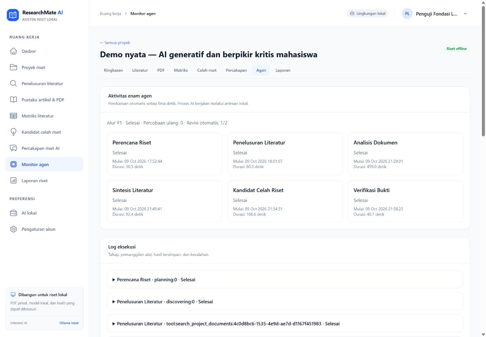

# Demo Akademik — Lima PDF Nyata

**Catatan historis:** hasil run 9 Oktober dicatat sebelum pemindahan seluruh AI ke Senopati. Runtime saat ini memakai chat qwen3:14b dan embeddinggemma:latest melalui gateway; PDF dan hasil lama dipertahankan. Panduan operasi terkini ada di [README](../README.md) dan [Senopati](senopati.md).

## Tujuan dan status bukti

Pertanyaan demo: **“Bagaimana pengaruh penggunaan generative AI terhadap kemampuan berpikir kritis mahasiswa?”**

Demo mode offline telah dijalankan pada proyek/run 1 dengan lima PDF nyata: 78 halaman, 338 chunk, dan embedding 1024 dimensi. Enam agen selesai setelah satu revisi, kemudian persetujuan melalui GUI sebagai **uji fungsi** dicatat pada 9 Oktober 2026 pukul 22:02:06 +07. Run berstatus `completed`; dua jawaban RAG nyata selesai dan laporan berhasil diunduh dengan hash cocok. Persetujuan penguji membuktikan alur aplikasi, bukan pengesahan kesimpulan ilmiah. Hasil tidak disimpulkan dari test mock.

## Sumber dokumen

Pada komputer implementasi, PDF berada di `%LOCALAPPDATA%\ResearchMate\demo-papers`. Manifest privat ada pada `storage/app/private/demo-input/manifest.json`; manifest bukan hasil analisis model. Di komputer lain, unduh PDF melalui halaman arXiv sebelum memutus internet.

| Berkas / sumber | Judul asli | Penulis / tahun |
| --- | --- | --- |
| [2509.00167](https://arxiv.org/abs/2509.00167) | Pilot Study on Generative AI and Critical Thinking in Higher Education Classrooms | W. F. Lamberti, S. R. Lawrence, D. White, S. Kim, S. Abdullah / 2025 |
| [2507.00181](https://arxiv.org/abs/2507.00181) | ChatGPT produces more “lazy” thinkers: Evidence of cognitive engagement decline | Georgios P. Georgiou / 2025 |
| [2505.24126](https://arxiv.org/abs/2505.24126) | How Students (Really) Use ChatGPT: Uncovering Experiences Among Undergraduate Students | Tawfiq Ammari, Meilun Chen, S M Mehedi Zaman, Kiran Garimella / 2025 |
| [2310.03192](https://arxiv.org/abs/2310.03192) | Generative AI in the Classroom: Can Students Remain Active Learners? | Rania Abdelghani, Hélène Sauzéon, Pierre-Yves Oudeyer / 2023 |
| [2507.00007](https://arxiv.org/abs/2507.00007) | Integrating Universal Generative AI Platforms in Educational Labs to Foster Critical Thinking and Digital Literacy | Vasiliy Znamenskiy, Rafael Niyazov, Joel Hernandez / 2025 |

Dokumen arXiv dapat berupa preprint. Keberadaan PDF bukan bukti penelaahan sejawat. Dalam mode offline, metadata eksternal tetap `metadata_unverified`.

Upload biasa memberi judul sementara dari nama berkas dan penulis/tahun kosong; aplikasi tidak mengarang metadata. Tabel ini berasal dari manifest persiapan. Jangan mengklaim aplikasi otomatis mengekstrak semua metadata tersebut dari PDF. Jika demonstrasi memakai metadata yang diimpor dari manifest, nyatakan langkah persiapan itu secara terpisah.

## Persiapan

1. Pasang dependensi/aset serta kedua model sesuai [README](../README.md).
2. Mulai PostgreSQL 16, server, dan worker; pastikan token serta koneksi Senopati tersedia. Jalankan `php artisan ai:check`; perbaiki kegagalan terlebih dahulu.
3. Pastikan PDF valid dan storage dapat ditulis. Jangan menjalankan test terhadap database pengguna.
4. Buka [aplikasi lokal](http://127.0.0.1:8000), daftar/masuk menggunakan akun sendiri.
5. Jelaskan bahwa inferensi saat ini memerlukan internet; mode dokumen lokal hanya membatasi penelusuran sumber.

Perangkat demo menggunakan RAM sekitar 16 GB dan RTX 3050 Ti 4 GB. Model chat `qwen3:4b`, embedding `qwen3-embedding:0.6b`, konteks 8192, dan timeout HTTP lokal 300 detik. Default 120 detik sebelumnya gagal pada analisis nyata; perubahan diikuti mulai ulang worker dan pemulihan run. Lima analisis kemudian selesai dan checkpoint per artikel dipakai kembali saat sintesis dipulihkan.

## Langkah presentasi

1. Buat proyek “Generative AI dan Berpikir Kritis Mahasiswa”. Isi pertanyaan di atas, topik yang sama, bahasa Indonesia, mode offline, target lima artikel, rentang tahun 2023–2026, dan tujuan membandingkan bukti serta keterbatasan.
2. Buka pustaka dokumen dan upload kelima PDF satu per satu. Status “tersimpan dan masuk antrean” belum berarti indeks selesai.
3. Tunggu semua dokumen `indexed`; periksa nomor halaman dan pesan error bila ada. Tunjukkan bahwa nama file, jumlah halaman, serta status berasal dari data nyata.
4. Mulai riset multiagen dari workspace. Buka monitor untuk melihat Planner dan Discovery serta log/waktu tahap.
5. Pada `awaiting_paper_selection`, buka literatur, tinjau rencana dan sumber, pilih lima artikel, lalu klik **Analisis artikel terpilih**.
6. Pantau Analysis, Synthesis, ResearchGap, dan Verification. Jangan melewati failure dengan mengganti output. Jika gagal, perbaiki gateway/timeout/schema lalu lanjutkan dari tahap tersimpan.
7. Buka matriks, coba pencarian dan urutan. Tunjukkan field tidak dilaporkan jika bukti tidak tersedia.
8. Buka kandidat celah, perluas **Lihat bukti pendukung dan batasan**, kemudian buka sumber. Jelaskan bahwa kandidat tidak membuktikan tidak ada studi lain.
9. Buka laporan untuk melihat status klaim: verified, unsupported, insufficient_evidence, atau perlu tinjauan. Periksa kutipan pada PDF asli; dukungan lokal tidak memverifikasi bibliografi eksternal.
10. Pada `awaiting_approval`, tinjau sumber, keterbatasan, serta hasil verifikasi. Checkbox persetujuan adalah pengakuan tinjauan manusia; jangan menyetujuinya otomatis atas nama presenter.
11. Setelah presenter menyetujui, status menjadi `completed`. Klik **Simpan laporan Markdown**, lalu unduh artifact privat. Jika diekspor sebelum approval, jelaskan status `awaiting_approval` dalam laporan sebagai draf.
12. Coba chat: “Bukti apa yang menunjukkan perubahan kemampuan berpikir kritis, dan apa keterbatasannya?” Periksa ID sumber/kutipan. Tanpa sumber sah, respons harus mengakui keterbatasan bukti.

## Batas yang harus dijelaskan

`AnalysisAgent` membaca maksimal **12 chunk pertama per artikel**, sedangkan chat menggunakan retrieval atas seluruh indeks yang cocok model/dimensinya. `full_text` menunjukkan PDF tersedia, bukan bahwa model membaca setiap halaman. Hasil yang bergantung pada bagian akhir, tabel, atau angka perlu diperiksa langsung. OCR belum tersedia. Konteks dan koleksi terbatas tidak mendukung klaim universal tentang seluruh literatur.

Metadata upload dapat tetap berupa nama file, dan bibliografi offline belum diverifikasi eksternal. Model kecil dapat gagal schema atau menghasilkan sintesis yang perlu revisi; aplikasi menyimpan error dan status bukti tanpa hasil sukses buatan.

Pada analisis nyata artikel pertama, tiga kutipan cocok dengan chunk, tetapi tujuan dan temuan masih memerlukan koreksi atribusi: sebagian temuan dari pengantar tentang studi lain tercampur dengan hasil pilot yang dianalisis. Output asli dipertahankan dalam jejak eksekusi. Prompt lalu diperjelas untuk membedakan hasil artikel sendiri dari literatur yang dikutip. Label **“Kutipan cocok — tinjau makna”** menjelaskan bahwa lolos pemeriksaan teks belum berarti seluruh isi analisis benar secara ilmiah; periksa setiap temuan pada sumber aslinya.

Percakapan awal gagal karena kutipan literal diubah model; pesan gagal tetap tersimpan. Jalur chat akhir memakai schema `citations: [{chunk_id}]`. Server menerima hanya ID dari retrieval proyek dan menyalin teks chunk asli sebagai kutipan; model tidak mentranskripsikan kutipan. Dua jawaban berikutnya selesai. Sumber yang sah tetap tidak membuktikan bahwa setiap penafsiran dalam jawaban tepat.

## Catatan eksekusi akhir

| Bukti | Status yang dicatat |
| --- | --- |
| Identitas dan waktu | Proyek 1, run 1; mode offline; selesai 9 Oktober 2026 pukul 22:02 +07 |
| PDF nyata dan manifest asal | Lima dokumen diunggah melalui UI; metadata asli diimpor dari manifest persiapan, tetap `metadata_unverified` |
| Ollama nyata | Chat JSON dan embedding lulus; panjang embedding 1024 |
| Indeks lima PDF melalui aplikasi | Proyek 1: 5 indexed, 78 halaman, 338 chunk, semua 1024 dimensi |
| Pemilihan artikel dan analisis | Lima artikel dipilih melalui GUI; lima analisis selesai setelah timeout diubah ke 300 detik. Tahap analisis pemulihan selesai 21:36:40, sekitar 7 menit 39 detik |
| Analisis artikel pertama | Tersimpan dengan tiga kutipan cocok; atribusi tujuan/temuan masih perlu tinjauan. Output asli dipertahankan, prompt diperjelas |
| Sintesis dan pemulihan | Percobaan lama timeout/truncated; input tahap dipersempit, sintesis berikutnya selesai sekitar 84 detik dan checkpoint lima analisis dipakai kembali |
| Enam agen dan verifikasi | Planner, Discovery, Analysis, Synthesis, ResearchGap, Verification selesai; verifikasi memicu satu siklus revisi sebelum `awaiting_approval` |
| Persetujuan uji fungsi | GUI pada akun penguji 1 mencatat `approved_by=1`, `approved_at=2026-10-09T22:02:06+07:00`, kemudian `completed`; bukan persetujuan ilmiah atas nama pengguna |
| RAG pertanyaan terfokus | Pesan asisten 6 selesai sekitar 23 detik; sumber chunk 1, 2, dan 20 |
| RAG pertanyaan utama demo | Pesan asisten 8 selesai sekitar 21 detik; sumber chunk 1, 302, 7, dan 39 |
| Matriks dan sumber | Lima baris; pencarian menghasilkan satu artikel yang sesuai, urutan tahun diperiksa, halaman bukti chunk 34 dibuka |
| PDF privat melalui GUI | Unduhan 146.082 byte; hash cocok dengan PDF asli |
| Laporan lengkap dan unduhan | Artifact 1/run 1, 32.570 byte; GUI berhasil mengunduh Markdown, hash sama dengan artifact privat |
| Monitor dan console | Desktop 1440×1000, lebar dokumen 1425 tanpa overflow; enam kartu agen selesai, run selesai, revisi 1/2; console warning/error kosong |

Laporan historis dapat [diunduh melalui aplikasi](http://127.0.0.1:8000/projects/1/reports/1) setelah masuk sebagai pemilik proyek. SHA-256 unduhan dan artifact privat identik:

```text
84BDD1E01CC1583FE4AA94D6B4465516877AEA4969AC37C8239C113CA1299B3C
```

Laporan mencantumkan status run `completed`, rencana, metadata dan statusnya, lima analisis, sintesis, kandidat celah, status klaim/kutipan, catatan verifikasi, serta batas konteks dan tinjauan makna. Kegagalan awal tetap tersimpan; status selesai tidak menghapus temuan yang perlu diperiksa.



Catatan ini membuktikan alur lokal dan asal berkas. Metadata preprint serta atribusi temuan tetap memerlukan penilaian pengguna sebelum dipakai sebagai hasil akademik.
