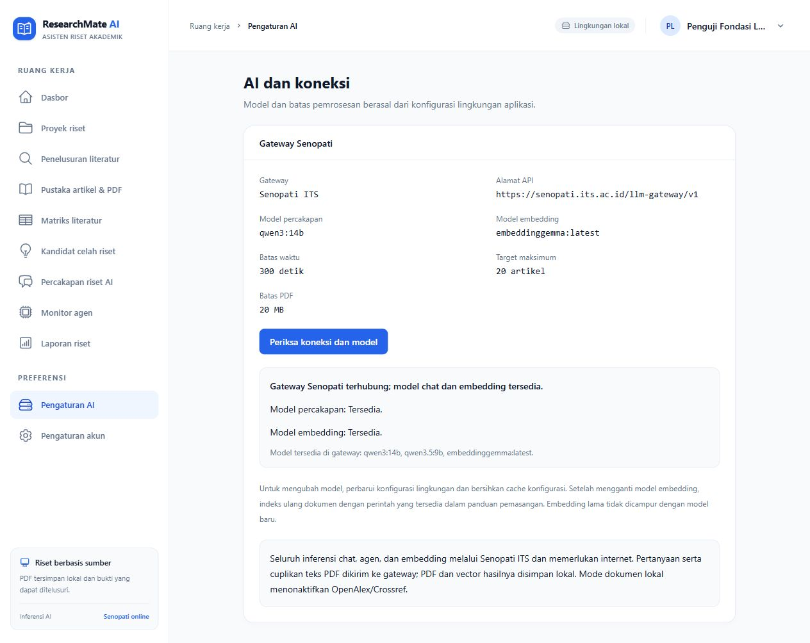

# Gateway Senopati ITS

Seluruh AI aplikasi memakai Senopati: chat/keenam agen **qwen3:14b** dan embedding **embeddinggemma:latest**. Tidak ada pilihan atau fallback model AI lokal.

## Konfigurasi

```dotenv
SENOPATI_API_KEY=isi_token_kelompok
SENOPATI_CHAT_MODEL=qwen3:14b
SENOPATI_EMBED_MODEL=embeddinggemma:latest
SENOPATI_TIMEOUT=300
```

Token kelompok disimpan pada .env yang diabaikan Git. Identitas kelompok terkait token, tanpa parameter tambahan pada API. Endpoint tetap pada https://senopati.its.ac.id/llm-gateway/v1: POST /chat/completions, POST /embeddings, GET /models. TLS aktif dan redirect nonaktif.

```powershell
php artisan config:clear
php artisan cache:forget ai.connection_status
php artisan queue:restart
# Tunggu worker lama selesai/keluar, lalu hidupkan worker kembali.
php artisan queue:work --tries=3 --timeout=1800 --sleep=1
php artisan ai:check
```

## PDF, embedding, dan akses internet

PDF, chunk, vector, database, dan laporan disimpan pada komputer. Pertanyaan, prompt agen, metadata, hasil tahap sebelumnya, dan teks sumber yang diperlukan dikirim ke Senopati. Mode dokumen lokal menonaktifkan OpenAlex/Crossref; semua inferensi tetap memerlukan internet/token/kuota.

Model embedding gateway yang diuji menghasilkan 768 dimensi. Aplikasi memvalidasi count, index, angka finite, norma bukan nol, dan dimensi konsisten; urutan respons direkonstruksi berdasarkan index. Jangan mencampur vector model lama dan baru. Perubahan model memerlukan ai:reindex dengan --force. Chunk yang dibangun ulang menyebabkan referensi historis ditandai untuk tinjauan; PDF asli tetap disimpan.

## Kontrak dan kegagalan

Schema JSON divalidasi di PHP dengan batas perbaikan. Pemanggilan alat mempertahankan tool_call_id, mengubah argumen JSON menjadi array PHP, dan tetap mematuhi allowlist, kepemilikan, validasi argumen, serta budget alat. 401/403 memerlukan pemeriksaan token; 429 memerlukan penundaan sampai batas penggunaan tersedia. Timeout/JSON/embedding tidak valid menggagalkan tahap; tidak ada hasil rekaan atau fallback AI lokal. Error gateway tidak diteruskan mentah kepada pengguna.

## Pengujian nyata

Pada 11 Oktober 2026, GET /models menampilkan qwen3:14b, qwen3.5:9b, dan embeddinggemma:latest. POST /embeddings berhasil dengan 768 dimensi. Chat, JSON schema, dan satu siklus alat telah diuji nyata. Hasil demo lima PDF pada 9 Oktober adalah catatan historis sebelum pemindahan AI; tidak diklaim sebagai run gateway baru.

```powershell
composer test
$env:RUN_SENOPATI_TESTS = '1'
php vendor/bin/phpunit --group senopati
Remove-Item Env:RUN_SENOPATI_TESTS
```

Test standar memakai token fixture dan HTTP mock, tanpa AI lokal atau permintaan gateway nyata. [Testing](testing.md) mencatat hasil suite terakhir. Kualitas atribusi dan kesimpulan tetap perlu tinjauan manusia.

Migrasi satu kali indeks demo pada 11 Oktober selesai: 338 embedding gateway/768 dimensi, ID dan teks chunk dipertahankan, run historis tetap completed. Retrieval nyata menghasilkan enam sumber milik proyek dengan model baru. Backup embedding lama disimpan privat; PDF, kutipan, dan laporan tidak dihapus. Gateway sempat timeout/429; migrasi melanjutkan checkpoint dan mengganti vector setelah seluruh batch berhasil.


