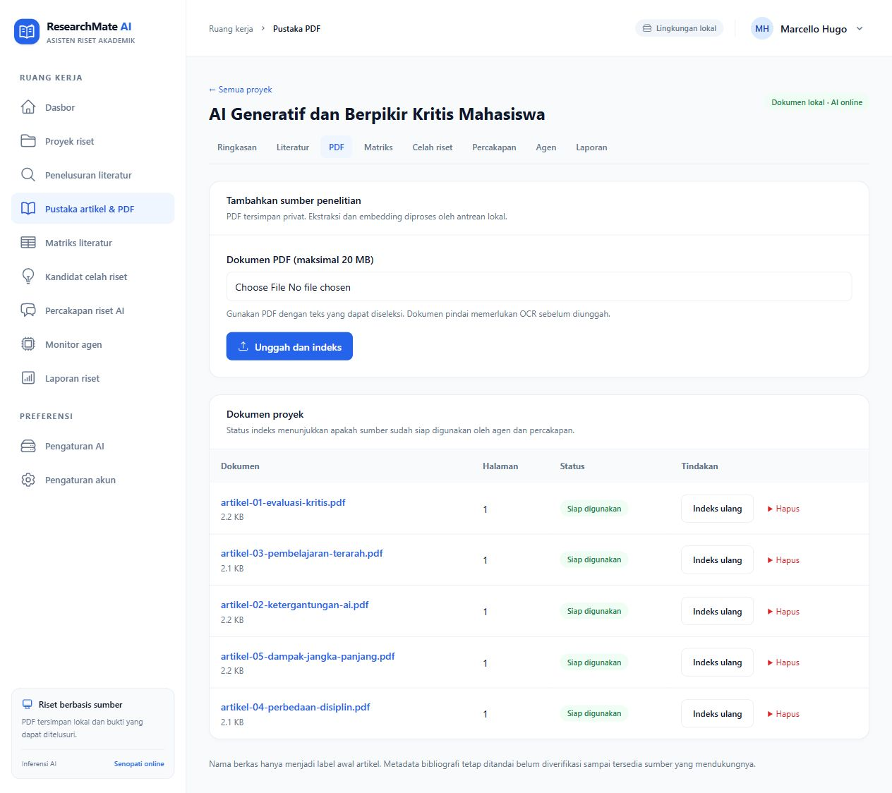

# Data pengujian proyek

Paket lima PDF berada di `database/fixtures/dummy-research`, bersama manifest proyek, metadata, dan isi dokumen. Label dummy tidak ditampilkan pada proyek, judul, atau PDF sesuai permintaan. Data tetap **fiktif**, bukan publikasi akademik nyata; metadata menggunakan `synthetic_fixture`, tanpa DOI, dan project settings menyimpan `synthetic=true`.

Tambahkan ke akun yang sudah terdaftar dengan ID pengguna yang tepat:

```powershell
php artisan research:seed-data 1
```

Perintah mengimpor proyek, artikel, dan PDF privat, lalu mengantrekan indeks melalui Senopati. Menjalankan ulang tidak menggandakan proyek/PDF atau menimpa hasil lama. Tidak membuat akun, mengganti password, atau mengisi hasil agen buatan. Worker harus aktif dan gateway harus tersedia agar dokumen menjadi terindeks.

Penerapan pada 12 Oktober 2026: proyek #3 pada akun Marcello Hugo mempunyai lima PDF satu halaman, lima chunk dengan embedding Senopati, semua berstatus indexed/Siap digunakan. Proyek #2 tersedia untuk akun penguji lama. Uji importer lulus dua test/46 assertion pada SQLite dan PostgreSQL khusus; Pint dan PHPStan lulus. Proyek disiapkan draft tanpa output agen buatan.

[Buka proyek akun aktif](http://127.0.0.1:8000/projects/3).



Setelah kelima PDF terindeks, buka proyek, klik mulai riset, tinjau pemilihan lima artikel, lalu analisis dan setujui hasil setelah pemeriksaan. Proyek disiapkan sebagai draft agar pengguna dapat mencoba alur sendiri.

Pertanyaan chat yang dapat dicoba:

- Bandingkan metode pada kelima dokumen.
- Dokumen mana yang membahas ketergantungan pada AI? Sertakan sumber.
- Apa keterbatasan bukti tentang dampak jangka panjang?
- Berapa persentase peningkatan kemampuan berpikir kritis? Angka tidak tersedia pada sumber; jangan mengarangnya.

Test importer memeriksa idempotensi, kepemilikan, PDF privat/hash, teks yang dapat diparsing, metadata fiktif tanpa DOI, job indeks, serta ketiadaan output agen buatan.

```powershell
php vendor/bin/phpunit tests/Feature/SeedResearchDataTest.php
```
